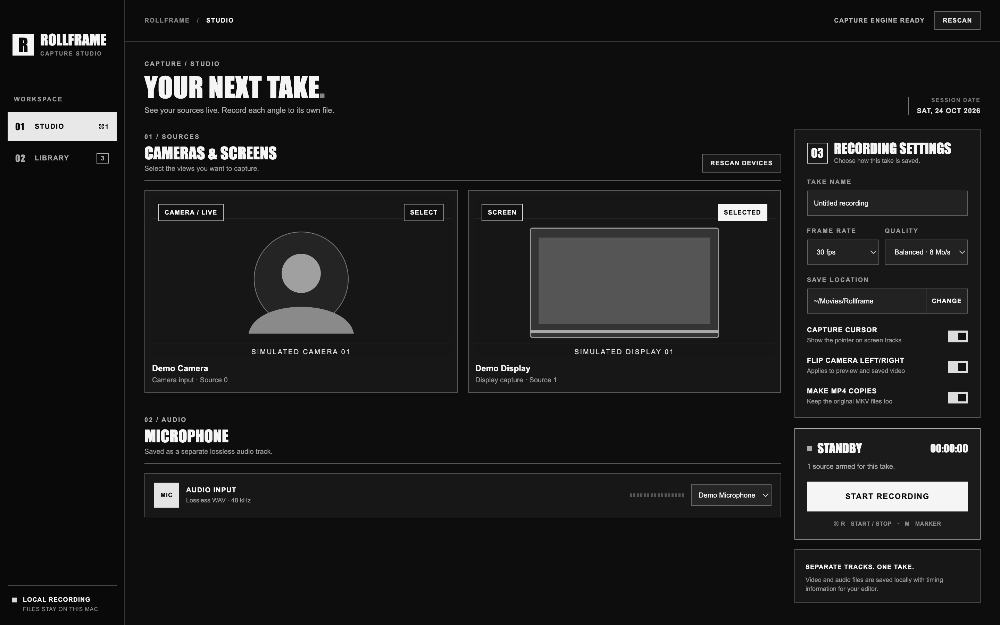
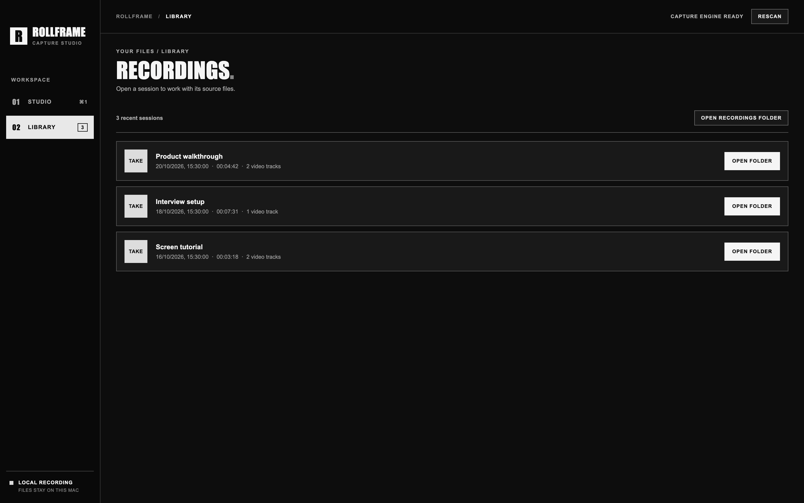

# Rollframe

A prototype with unresolved camera preview lag, choppiness, and sizing issues reported by the user. See [MEMORY.md](MEMORY.md) for the current handoff.

## Screenshots

These screenshots use simulated sources and sample session data, with no personal camera footage or device names.





A visual macOS recorder for independent screen, camera, and microphone tracks. Recordings stay on your Mac. Each selected display is captured in one FFmpeg process to avoid macOS concurrent screen capture hangs. Cameras and the microphone use independent processes. Sessions keep crash-safe MKV files, optional MP4 copies, a WAV microphone track, `session.json`, and `notes.md`.

## Run

Requires macOS, Node.js 20+, and FFmpeg (`brew install ffmpeg`).

```sh
cd rollframe
npm install
npm start
```

Grant Screen Recording, Camera, and Microphone access to the app or launching terminal in macOS System Settings. Live camera preview uses the same FFmpeg camera capture path as recording. Restart after changing Screen Recording permission.

## Features

- Select multiple displays and cameras, with one file per source. Camera tiles show a full-frame live FFmpeg preview at up to 24 fps with stale frames dropped before and during recording; screen tiles show a still identification frame.
- Capture an isolated lossless microphone track.
- Save crash-safe MKVs and optional MP4 copies.
- Choose 24, 30, or 60 fps, H.264 quality, cursor capture, camera left/right flip, and output folder. The camera flip setting changes both live previews and new recordings.
- View live file size, elapsed time, and microphone activity.
- Add timeline moment markers with **M**. Start or stop with **⌘R**.
- Browse recent sessions and open their folders.

## Contributing and license

Contributions are welcome through issues and pull requests. See [CONTRIBUTING.md](CONTRIBUTING.md). Rollframe is released under the [MIT license](LICENSE). The required third-party MIT notice for adapted capture code is retained in [LICENSE-justroll](LICENSE-justroll). Only the repository owner merges pull requests.
